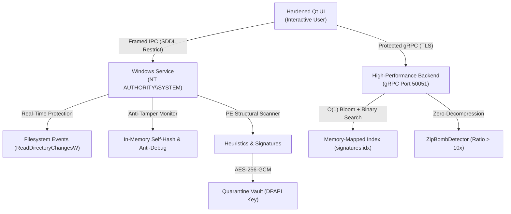

# Vantor — Hardened Windows Endpoint Antivirus Solution

[](https://www.microsoft.com/windows)
[](https://isocpp.org/)
[](#)
[](#)
[](#)

---

## Overview

**Vantor** is a production-grade, hardened, Windows-only antivirus and endpoint detection solution designed with defense-in-depth principles. 

The architecture decouples system-level scanning and protection into an isolated **Win32 C++ Windows Service**, a **high-speed gRPC backend** powered by a hybrid SQLite and memory-mapped signature index, a **comprehensive user-mode anti-tamper subsystem**, and a **hardened Qt graphical user interface** with zero-latency visual rendering and zip-bomb mitigation.

---

## Core Components

```text
Vantor/
├── CMakeLists.txt              # Unified root CMake orchestrating all targets
├── vcpkg.json                  # Reproducible dependency specification
├── proto/
│   └── vantor.proto            # gRPC protocol buffer definitions
├── common/                     # Common headers, Win32 BCrypt crypto, SDDL named pipe IPC
│   ├── Common.h
│   ├── Crypto.h
│   ├── NamedPipe.h
│   └── Logger.h
├── service/                    # Pure C++ Windows Service (SYSTEM / Win32 API)
│   ├── main.cpp                # SCM ServiceMain, installation, control handler
│   ├── Scanner.cpp             # Multi-threaded file scanner, PE features, heuristics
│   ├── ConfigManager.cpp       # Windows DPAPI encrypted configuration
│   ├── IPC.cpp                 # SDDL-restricted named pipe server
│   ├── AntiTamper.cpp          # WinVerifyTrust, runtime self-hash, anti-debug/VM
│   └── RealTimeProtection.cpp  # Filesystem monitoring & instant threat termination
├── backend/                    # High-Performance Backend (gRPC / CLI)
│   ├── main.cpp                # CLI entry point (VantorBackend.exe)
│   ├── GrpcServer.cpp          # gRPC endpoints (UpdateSignatures, Telemetry, Config)
│   ├── SignatureStore.cpp      # Hybrid SQLite + Memory-Mapped Bloom index (> 200 MB/s)
│   ├── ZipBombDetector.cpp     # Zero-decompression archive inspection & ratio checking
│   └── tests/                  # Security & integrity test suite (GoogleTest compatible)
├── ui/                         # Hardened Qt GUI
│   ├── main.cpp                # High-DPI application entry point
│   ├── mainwindow.cpp          # Security dashboard, 60 FPS radar sweep, drag-and-drop
│   ├── QuarantineDialog.cpp    # Encrypted quarantine containment vault
│   ├── SettingsDialog.cpp      # Policy configuration, sensitivity sliders
│   ├── GrpcClient.cpp          # Async TLS/token-protected client with pipe fallback
│   ├── ZipBombGuard.h          # Pre-scan archive inspection filter
│   ├── performance/            # FrameRateLimiter (smooth 60 FPS, < 1% idle CPU)
│   └── theme/                  # Professional dark theme stylesheet & vector SVGs
├── installer/
│   └── Product.wxs             # WiX toolset XML producing signed MSI installer
├── docs/                       # Technical & security documentation
│   ├── Architecture.md         # Component diagrams & data flows
│   ├── SecurityChecklist.md    # Security audit, mitigations, and compliance
│   └── SignatureUpdateGuide.md # Bulk importing & signature distribution guide
└── .github/workflows/
    └── ci.yml                  # GitHub Actions workflow for build, test, signing, MSI
```

---

## Architecture Flow



For complete technical specifications, see [docs/Architecture.md](file:///c:/Users/tirth/Downloads/Projects/Vantor/docs/Architecture.md).

---

## Building Vantor

### Prerequisites
- **Operating System**: Windows 10 or Windows 11 (64-bit).
- **Toolchain**: Microsoft Visual Studio 2022/2026 with C++ desktop workload (MSVC v143/v145).
- **Build System**: CMake 3.20 or newer.
- **Dependencies**: Native Windows SDK (includes BCrypt, Crypt32, WinTrust, Advapi32, WinSock2). Optional Qt6 for GUI.

### Build via CMake

```powershell
# 1. Configure the project for 64-bit Windows
cmake -B build -S . -A x64 -DCMAKE_BUILD_TYPE=Release

# 2. Compile all targets (Service, Backend, Tests, UI)
cmake --build build --config Release --parallel

# 3. Run the automated test suite
cd build\backend\tests\Release
.\VantorTests.exe
```

---

## Operational Commands

### 1. Windows Service Management (`VantorService.exe`)
Run elevated as Administrator:

```powershell
# Install and register with Windows Service Control Manager (Auto-Start)
.\VantorService.exe --install

# Run interactively in console mode (for development / debugging)
.\VantorService.exe --console

# Uninstall and deregister the service
.\VantorService.exe --uninstall
```

### 2. Backend & CLI Engine (`VantorBackend.exe`)

```powershell
# Launch gRPC daemon on port 50051
.\VantorBackend.exe server --port 50051

# Trigger on-demand scans via the Windows Service
.\VantorBackend.exe scan quick
.\VantorBackend.exe scan full
.\VantorBackend.exe scan custom "C:\path\to\folder"

# Inspect archive for zip-bombs, nested archives, and path traversal
.\VantorBackend.exe inspect-zip "path\to\archive.zip"

# Manage signature store & import text feeds
.\VantorBackend.exe db --stats
.\VantorBackend.exe db --import "path\to\sha256_hashes.txt"

# Execute comprehensive Anti-Tamper self-audit
.\VantorBackend.exe verify
```

---

## Security Hardening Highlights

- **Control Flow Guard (CFG)**, **High-Entropy ASLR**, and **DEP** enforced on all binaries.
- **User-Mode Anti-Tamper**:
  - `WinVerifyTrust` Authenticode signature checks on all PE modules.
  - Runtime in-memory `.text` code section self-hash validation to detect in-memory code patching.
  - Proactive inline hook detection on critical Win32 API preambles.
  - Multi-vector anti-debug routines (PEB, NT Debug Ports, Hardware Breakpoint registers `Dr0`-`Dr3`, `ThreadHideFromDebugger`).
  - RDTSC instruction timing analysis detecting CPUID hypervisor virtualization traps.
  - Automatic self-repairing watchdog restoring corrupted files from protected backup.
- **Archive & Zip-Bomb Protection**:
  - Pure zero-decompression inspection rejecting archives with compression ratios exceeding 10.0x, files > 1 GB, or > 10,000 entries.
- **Encrypted Quarantine Vault**:
  - AES-256-GCM authenticated encryption with DPAPI machine-protected master key.

For the detailed audit, review [docs/SecurityChecklist.md](file:///c:/Users/tirth/Downloads/Projects/Vantor/docs/SecurityChecklist.md).

---

## License

Copyright (c) 2026 Vantor Security. All rights reserved.
