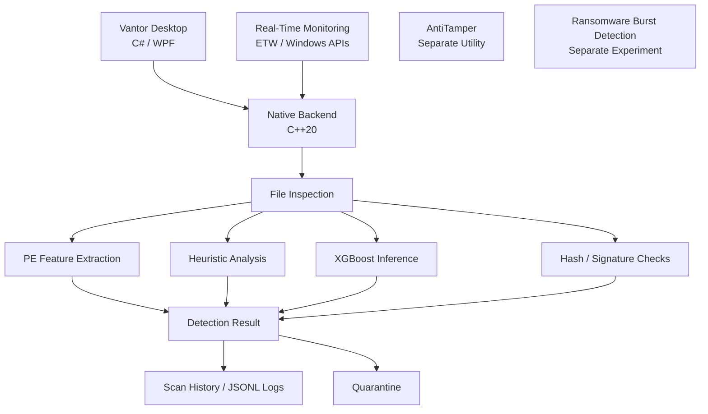

# Vantor

### A Windows security research project exploring malware detection, behavioural monitoring, and system protection.

[](https://www.microsoft.com/windows)
[](https://isocpp.org/)
[](https://dotnet.microsoft.com/)
[](#)
[](https://github.com/tirthsaraiya29/Vantor/actions)

---

## Overview

**Vantor** is an experimental Windows security suite focused on exploring the engineering behind endpoint protection, malware analysis, and host-level threat detection.

Built around a native C++ security engine and a C# desktop application, Vantor brings together multiple approaches to file inspection and system monitoring, including machine-learning-assisted classification, static file analysis, heuristic evaluation, cryptographic hashing, quarantine operations, and event-driven monitoring.

The project is designed as a modular security research environment: individual components investigate different parts of the endpoint security problem, from identifying suspicious executable files to observing potentially malicious system activity.

Rather than relying on a single detection technique, Vantor explores how multiple signals can contribute to a more informed security assessment.

> **Project status:** Active development / experimental. Vantor is not a certified antivirus product or a replacement for Windows Defender or other established endpoint security solutions.

---

## Core Components

### 1. Vantor Desktop

A native Windows desktop application built using **C#, WPF, and .NET 10**.

The desktop application provides a central interface for interacting with the scanning engine and reviewing security-related information.

Current functionality includes:

- **Security dashboard** — A central interface for accessing scanning functionality.
- **Quick scan** — Inspects common user directories, including Downloads, Desktop, and Documents.
- **Full scan** — Traverses available drives and inspects accessible files.
- **Scan progress** — Displays scanning activity and processing progress.
- **Scan summaries** — Presents scan results and threat counts.
- **Scan history** — Retrieves previously recorded scan sessions.
- **Quarantine management** — Displays quarantined-file metadata and provides restoration and deletion actions.

The application communicates with the native backend through a locally launched process and reads structured JSONL scan logs to update its interface.

### 2. Native Detection Engine

The core scanning engine is implemented in **C++20** and provides the underlying file-inspection functionality.

Its architecture combines multiple analysis techniques:

| Component | Purpose |
|---|---|
| File hashing | Computes SHA-256 and SHA-512 digests |
| Safe-file database | Tracks previously identified file hashes |
| PE feature extraction | Extracts structural characteristics from Windows executable files |
| Machine learning | Uses XGBoost models for classification inference |
| Heuristic analysis | Evaluates file characteristics and contextual indicators |
| Signature tracking | Maintains hash-based detection information |
| Scan history | Records scanning sessions and individual file verdicts |
| Structured logging | Writes timestamped JSONL security events |

#### Machine-learning-assisted analysis

Vantor integrates XGBoost through its native C API.

The feature extraction implementation examines Portable Executable (PE) characteristics, including:

- PE section count and characteristics.
- Image size and entry-point information.
- Section entropy measurements.
- Writable and executable section characteristics.
- PE checksum information.

Extracted features are passed to loaded models to obtain classification scores.

The current backend configuration references the `ember.json` and `avast.json` model files.

Model predictions are used as one component of the overall detection process rather than being treated as independent proof that a file is malicious.

#### Heuristic analysis

The heuristic engine evaluates contextual and structural indicators, including:

- Digital signature verification.
- Executable file characteristics.
- File size.
- Execution from commonly abused directories.
- Suspicious double-extension patterns.

These signals contribute to a normalized heuristic score.

#### Cryptographic identification

Files processed by the scanning engine are evaluated using SHA-256 and SHA-512 hashing.

Hash information supports file identification, safe-file tracking, scan records, and quarantine metadata.

### 3. Real-Time Protection

Vantor includes a native Windows real-time monitoring implementation.

The current implementation explores event-driven detection using Windows facilities, including:

- Event Tracing for Windows (ETW).
- Kernel process event monitoring.
- Filesystem activity monitoring.
- Registry persistence monitoring.
- Startup-directory monitoring.
- Suspicious executable inspection.

The monitoring implementation can inspect discovered files using the scanning engine and initiate protective actions when a malicious verdict is returned.

Depending on the detection path, these actions include process termination and quarantine handling.

**Note:** Real-time monitoring is an evolving component. Its coverage, reliability, privilege requirements, and resistance to evasion require further testing.

### 4. Quarantine System

Vantor implements a quarantine mechanism intended to isolate files identified as malicious.

The current implementation includes:

- AES-256-GCM authenticated encryption.
- Randomly generated encryption initialization vectors.
- Authentication tags for integrity verification.
- Windows DPAPI protection for the stored encryption key.
- SQLite-backed quarantine metadata.
- SHA-256 and SHA-512 identification records.
- File restoration functionality.

Quarantined files are encrypted and their metadata is recorded separately.

Restoration requires access to the corresponding protected encryption key and successful authentication of the encrypted content.

Quarantine operations are destructive to the original file when successfully completed. Use the application only in an environment where you can safely recover your data.

### 5. AntiTamper

The `AntiTamper` directory contains a separate native Windows utility exploring user-mode file-integrity monitoring.

Its current implementation includes:

- SHA-512 integrity measurements.
- Baseline file verification.
- Backup copies of monitored files.
- Periodic integrity checks.
- Directory-change monitoring using `ReadDirectoryChangesW`.
- Restoration attempts when monitored files are modified or removed.

This component is an experimental integrity-monitoring implementation, not a security boundary against an attacker with sufficient privileges.

### 6. Ransomware Burst Detection

The `Ransomware Burst Detection/RBD` directory contains a separate C++ research implementation exploring behavioural ransomware detection.

It investigates the use of:

- ETW kernel file events.
- Process-level activity tracking.
- File-write activity rates.
- Directory distribution.
- File entropy measurements.
- Behavioural scoring.
- Process termination when configured detection thresholds are reached.

The implementation explores how patterns of filesystem activity can provide signals beyond conventional static file inspection.

RBD is maintained as a separate experimental component and should not be assumed to be integrated into the primary desktop application's scanning workflow.

---

## Architecture

Vantor is organized around a desktop interface, a native scanning engine, and separate security research modules.

```text
Vantor/
│
├── .github/
│   └── workflows/
│       └── codeql.yml
│
├── Vantor/
│   ├── App.xaml
│   ├── MainWindow.xaml
│   ├── MainWindow.xaml.cs
│   └── Vantor.csproj
│
├── VantorBackend/
│   ├── main.cpp
│   ├── VantorBackend.cpp
│   ├── VantorBackend.h
│   ├── RTP.cpp
│   ├── feature_extractor.cpp
│   ├── heuristic.cpp
│   ├── mlinference.cpp
│   ├── quarantine.cpp
│   ├── scan_full.cpp
│   ├── scan_quick.cpp
│   ├── recursive.cpp
│   ├── signatures.cpp
│   ├── logging.cpp
│   └── ...
│
├── AntiTamper/
│   └── AntiTamper.cpp
│
├── Ransomware Burst Detection/
│   └── RBD/
│       └── RBD.cpp
│
└── VantorSuite/
    └── VantorSuite.slnx
```

*The tree above highlights the principal source components; generated build output, dependencies, and supporting files are intentionally omitted.*

### Component relationship



---

## Technology Stack

| Technology | Role |
|---|---|
| C++20 | Native security and scanning engine |
| C# | Desktop application |
| WPF | Windows graphical interface |
| .NET 10 | Desktop application runtime |
| XGBoost | Machine-learning inference |
| SQLite | Scan history and quarantine metadata |
| OpenSSL | Cryptographic operations |
| Windows DPAPI | Encryption-key protection |
| Windows ETW | Event-driven system monitoring |
| Windows API | Filesystem, process, registry, and PE-related operations |
| GitHub Actions | Automated workflow execution |
| CodeQL | Static application security analysis |

---

## Development Environment

Vantor is currently developed for Windows.

### Requirements

The source projects indicate the following development requirements:

- Windows 10 or Windows 11.
- Visual Studio with C++ desktop development tools.
- Windows SDK.
- MSVC toolchain supporting C++20.
- .NET 10 SDK.
- XGBoost development libraries.
- OpenSSL development libraries.
- SQLite development libraries.

Additional native dependencies and library configurations are required by the C++ backend.

The current Visual Studio project configuration contains machine-specific dependency paths. These must be adapted to your local development environment before expecting a clean build on another machine.

### Building

Clone the repository:

```bash
git clone https://github.com/tirthsaraiya29/Vantor.git
cd Vantor
```

Build the desktop project:

```bash
dotnet restore Vantor/Vantor.csproj
dotnet build Vantor/Vantor.csproj -c Release
```

The native backend must be built separately using its Visual Studio project and the required native dependencies.

Ensure the resulting backend executable and its required runtime dependencies are placed where the desktop application expects them.

**Important:** A successful .NET build alone does not produce a complete, runnable Vantor installation. The native backend, XGBoost runtime, model files, and other native dependencies must also be available.

---

## Security and Responsible Use

Vantor interacts with sensitive parts of the Windows operating system, including filesystems, processes, registry locations, and executable files.

Some components can terminate processes, encrypt files, or remove originals during quarantine operations.

Please observe the following precautions:

1. Test in a disposable Windows virtual machine before using the software on a primary system.
2. Maintain independent backups of important data.
3. Do not test detection or quarantine functionality against files you cannot afford to lose.
4. Do not assume that an ML score or heuristic verdict establishes that a file is malicious.
5. Review the implementation before enabling elevated privileges or automated protective actions.
6. Do not use the project to interfere with systems or data without authorization.

Vantor is intended for software development, security research, and controlled experimentation.

It has not been independently validated as a production endpoint security solution.

---

## Current Development Status

Vantor is an ongoing engineering project.

Its source tree contains multiple independently developed components, and their maturity and integration levels differ.

The primary desktop application and scanning backend are under development. The real-time protection, anti-tamper, and ransomware behaviour detection implementations require continued validation and testing.

The project does not currently publish independently verified malware detection rates, false-positive rates, performance benchmarks, or production security guarantees.

Contributions that improve reliability, correctness, maintainability, and security are welcome.

---

## Roadmap

Areas for continued development include:

- [ ] Strengthen the integration between the desktop application and native backend.
- [ ] Improve backend lifecycle management and error reporting.
- [ ] Improve detection consistency and reduce false positives.
- [ ] Validate model provenance, feature compatibility, and inference results.
- [ ] Improve real-time monitoring coverage and reliability.
- [ ] Strengthen quarantine recovery and failure handling.
- [ ] Improve portability of native build configurations.
- [ ] Expand automated security testing.
- [ ] Improve documentation and reproducible build instructions.
- [ ] Validate independent security research components in isolated environments.

---

## Contributing

Contributions, bug reports, and technical discussions are welcome.

If you would like to contribute:

1. Fork the repository.
2. Create a dedicated feature branch.
3. Make focused, reviewable changes.
4. Test the affected components in an isolated Windows environment.
5. Submit a pull request describing the implementation, testing performed, and any known limitations.

For security-sensitive issues, avoid publishing exploitable details in public issue reports before responsible disclosure can be arranged.

---

## License

A license has not yet been established in the repository.

Until a license is added, do not assume that the source code is available for unrestricted redistribution, modification, or commercial use.

---

## Repository

**Vantor — Windows Security Research**

[GitHub Repository](https://github.com/tirthsaraiya29/Vantor)

Built with a focus on understanding, engineering, and improving Windows endpoint security.