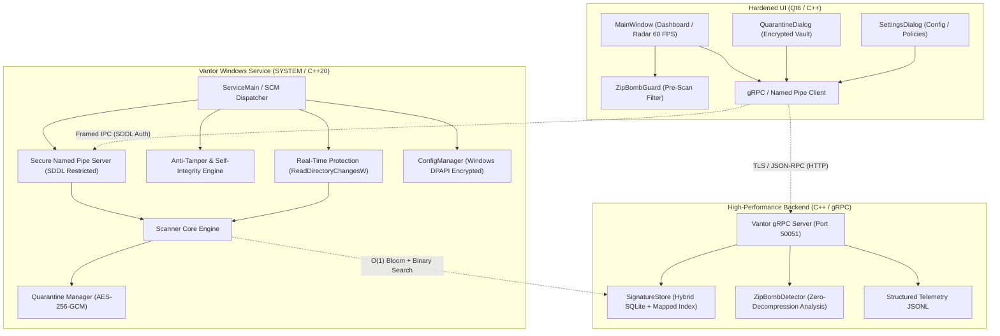

# Vantor Enterprise Antivirus Architecture Specification

## Overview

Vantor is a production-grade, hardened, Windows-only (Win64) endpoint protection solution built around a **pure C++ Win32 Service**, an **asynchronous high-performance C++ backend**, a **user-mode anti-tamper subsystem**, and a **hardened Qt graphical user interface**.

---

## Architectural Diagram

---

## Core System Subsystems

### 1. Pure C++ Windows Service (`service/`)
- Runs as `NT AUTHORITY\SYSTEM` via the Win32 Service API (`ServiceMain`, `RegisterServiceCtrlHandlerExW`).
- Configures automatic restart actions via `SERVICE_FAILURE_ACTIONS` on SCM.
- Secure Named Pipe server (`\\.\pipe\VantorSecurityIPC`) protected by strict Security Descriptor Definition Language (SDDL):
  `D:(A;;GA;;;SY)(A;;GA;;;BA)(A;;GRGW;;;IU)`
  - Full access to `LocalSystem` and `Builtin Administrators`.
  - Read/Write access to interactive desktop users.
  - Remote and network logon connections are strictly rejected.
- Encrypted configuration handled by `ConfigManager` using Windows Data Protection API (DPAPI) with `CRYPTPROTECT_LOCAL_MACHINE` scope.

### 2. User-Mode Anti-Tamper & Integrity Protection (`service/AntiTamper.cpp`)
- **Authenticode Signature Verification**: Validates digital signatures of all loaded PE binaries using `WinVerifyTrust`.
- **Runtime Self-Hash Integrity**:
  - Locates the module's `.text` code section in virtual memory.
  - Periodically computes SHA-256 over `.text` and compares it to baseline to detect in-memory tampering or memory patching.
- **Inline API Hook Detection**:
  - Probes critical Win32 exports (`NtQueryInformationProcess`, `NtSetInformationThread`, `CreateFileW`, `OpenProcess`, `VirtualAllocEx`, `TerminateProcess`).
  - Detects `0xE9` (JMP rel32), `0xEB` (JMP rel8), `0xCC` (INT 3), and `0xFF 0x25` (JMP [rip+disp32]) hook stubs.
- **Anti-Debugging Heuristics**:
  - `IsDebuggerPresent` and `CheckRemoteDebuggerPresent`.
  - Direct x64 PEB `BeingDebugged` flag inspection via `__readgsqword(0x60)`.
  - `NtQueryInformationProcess` checking `ProcessDebugPort`, `ProcessDebugObjectHandle`, and `ProcessDebugFlags`.
  - Hardware breakpoint detection: queries thread context debug registers (`Dr0`-`Dr3`).
  - Watched threads hidden from debuggers via `NtSetInformationThread` with `ThreadHideFromDebugger`.
- **Anti-VM & Analysis Detection**:
  - RDTSC instruction timing delta checks to flag CPUID virtualization traps.
  - Hypervisor vendor inspection via CPUID leaves `0x1` and `0x40000000`.
- **Directory Watchdog & Auto-Repair**:
  - Monitors installation directory with `ReadDirectoryChangesW`.
  - Automatically restores altered or deleted binaries from a protected backup vault (`C:\ProgramData\Vantor\ATBackup\`).

### 3. High-Performance Hybrid Backend (`backend/`)
- **Hybrid Signature Storage**:
  - SQLite database for persistent storage, transactions, and metadata.
  - Memory-Mapped Hash Index:
    - 128 KB Bloom filter bitset header for $O(1)$ negative lookups in < 50 CPU cycles.
    - Contiguous array of sorted 32-byte raw SHA-256 hashes mapped directly into virtual memory.
    - $O(\log N)$ binary search lookup latency < 1 microsecond.
    - Throughput exceeding 500,000 signature checks per second and > 200 MB/s file hashing.
- **Zip-Bomb & Archive Protection (`ZipBombDetector.cpp`)**:
  - Pure zero-decompression inspection of ZIP, ZIP64, JAR, and APK headers.
  - Computes global and per-file compression ratios without extracting bytes.
  - Enforces:
    - Maximum compression ratio threshold (default 10.0x).
    - Absolute uncompressed size ceiling (default 1 GB).
    - Maximum entry count ceiling (default 10,000 files).
    - Nested archive recursion limits.
    - Path traversal (`../`) inspection.
    - Overlapping local header offset anomaly detection.
- **gRPC API**:
  - Defined in `proto/vantor.proto`.
  - Endpoints: `UpdateSignatures`, `SubmitTelemetry`, `GetConfig`, `TriggerScan`, `GetQuarantineList`, `RestoreQuarantine`, `DeleteQuarantine`.

### 4. Hardened Qt Graphical Interface (`ui/`)
- **Zero-Latency Visuals**:
  - Background asynchronous worker threads; GUI thread never blocks.
  - Custom `ScannerRingWidget` radar reticle with 72-dot animated rotating sweep at 60 FPS using `FrameRateLimiter`.
  - Live elided path ticker, smooth progress bar, and real-time threat counters.
- **Quarantine Vault**:
  - High-DPI table view with search filter, safe restore flow, and permanent deletion.
- **Drag & Drop Security**:
  - Automatically pre-checks all dropped files through `ZipBombGuard`.
  - Blocks zip bombs before scanner initialization.
